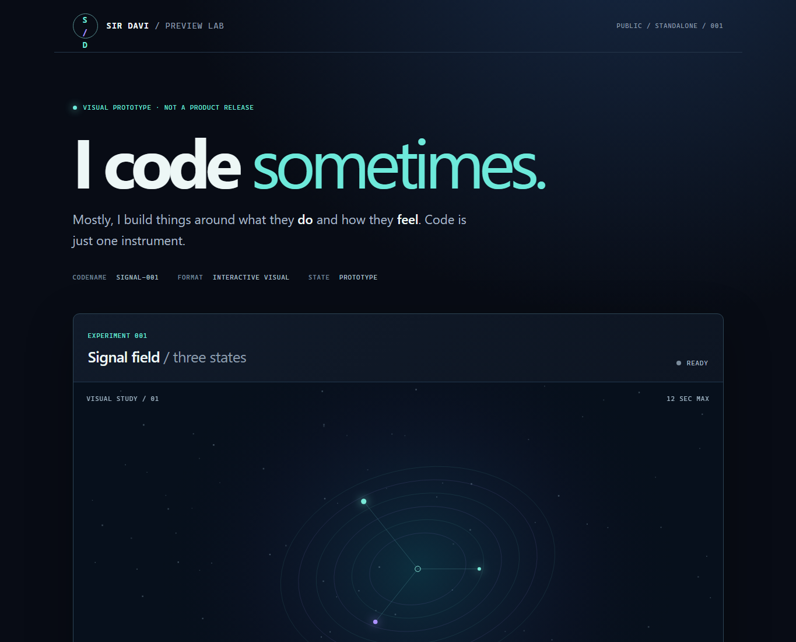

# I code sometimes. / Preview Lab

**A small public window into function, design, visual behavior and verification.**

This is an **original standalone visual preview**, not a source mirror or official release of any private project. Public entries use **codenames** until the owner authorizes an external project name and release. No public mapping to private projects, internal CIDs, branches, services, or source locations is provided.

## SIGNAL-001 / Signal Field

The first [source-backed preview](docs/index.html) contains three procedural interpretations of one abstract field: Orbit, Wave, and Signal.

A bounded headless Chrome startup smoke confirmed that the original HTML, CSS and JavaScript loaded and generated this capture. Interactive controls, full accessibility behavior, and human visual acceptance still require separate review.

- Pure checked-in HTML, CSS and JavaScript. No runtime dependencies, network calls, analytics, external fonts or private source.
- Playback requires an explicit click, lasts at most **12 seconds**, and is limited to about **30 frames per second**. Pause, Resume and Stop controls work locally. Background tabs pause automatically.
- Reduced-motion settings are respected by showing a static field until the user explicitly requests playback.
- This is a visual interaction prototype, not an application release, hardware benchmark, or statement about any private project.

## Transition and release evidence

The [public preview catalog](previews/index.json) is validated by the [source validator](scripts/validate_preview.py). Every entry names a codename, local asset, visibility classification, maturity stage and evidence states for source, browser, owner review and packaging.

Current status: **prototype**. Source checks run in CI. Browser review is **NOT_RUN** until actually exercised in a browser. Owner review/acceptance of the public prototype is **pending**. Packaging is **not packaged**.

A green source test does not make a demo installed, browser-tested, packaged, operational or owner-accepted. Promotion requires separate, attributable receipts and owner authorization.

## Workflow

1. Develop a standalone, expressly public visual or functional demonstration. No private source mirrors.
2. Register it under a temporary **codename only**.
3. Write reproducible tests for changes, verify native behavior where applicable, and capture material browser/display results.
4. Keep review receipts and objective scope distinct. The owner personally double-checks the work and factual claims, with agent assistance for development and review.
5. Promote a candidate or release only after explicit owner acceptance, even if CI passes.

Reproduce validation locally:

    python -m unittest discover -s tests -v
    python scripts/validate_preview.py

To run the static page without background infrastructure, start a temporary local server:

    python -m http.server 8000 --directory docs

Then browse to http://127.0.0.1:8000 and stop the server afterward.

## Public boundary

No internal endpoints, credentials, device inventory, private code, actual private project name mappings, owner coordination receipts, operational screenshots, protected ports or release-sensitive artifacts are permitted here.

**Attribution:** agent-assisted research, implementation, testing and review with personal human oversight and fact-checking by the owner. External review and release gates remain separate.